# Universal Mail — Kullanım Kılavuzu

Bu kılavuz, Universal Mail'i her gün kullanacak kişi içindir. Teknik bilgi gerekmez. Uygulamanın nasıl kurulacağı
[Kurulum Rehberi](KURULUM.md)'nde anlatılır; bu belge kurulumdan sonrasını anlatır.

Universal Mail üç işi bir arada yapar:

1. **Bulur:** seçtiğiniz şehirde yeni açılan veya yakında açılacak işletmeleri (kafe, restoran, otel, ofis…) Google
   Haritalar verisinden bulur.
2. **E-postasını arar:** işletmenin kendi web sitesinden genel iletişim adresini (ör. `info@…`) bulur.
3. **Kontrollü yazar:** sizin onayladığınız şablonlarla, günlük sınırlar ve yasal kurallar içinde tanıtım e-postası
   gönderir; yanıtları ve "listeden çıkmak istiyorum" taleplerini takip eder.

Bütün verileriniz **yalnızca sizin bilgisayarınızda** durur. Uygulama, geliştiricisine hiçbir veri göndermez.

> **Ekran görüntüleri hakkında:** Bu kılavuzdaki görüntüler **Demo modunda** alınmıştır. Demo modunda Google'a
> bağlanılmaz, işletmeler ve adresler yapaydır (adresler `.example` ile biter) ve hiçbir e-posta gerçek bir kişiye
> gitmez. Ekranın sağ üstündeki mor **DEMO** rozeti bunu gösterir. Gerçek kullanımda ekranlar aynıdır, yalnızca veriler
> gerçektir.

## İçindekiler

- [1. Başlarken](#1-başlarken)
- [2. Günlük iş akışı](#2-günlük-iş-akışı)
- [3. Ayarlar](#3-ayarlar)
- [4. Yedek alma ve geri yükleme](#4-yedek-alma-ve-geri-yükleme)
- [5. Veri saklama süreleri ve veri silme](#5-veri-saklama-süreleri-ve-veri-silme)
- [6. Yasal hatırlatmalar](#6-yasal-hatırlatmalar)
- [7. Sorun giderme](#7-sorun-giderme)

---

## 1. Başlarken

### 1.1 Kurulum sihirbazı (ilk açılış)

Uygulamayı ilk kez açtığınızda altı adımlık bir sihirbaz çıkar. Sağ üstten dili (Türkçe / English) seçebilirsiniz.
Her adımda **Geri** ile önceki adıma dönebilirsiniz; yazdıklarınız kaybolmaz.

1. **Onay:** Kullanım şartlarını okuyun, adınızı ve unvanınızı yazın, kutuyu işaretleyin. Onay tarihiyle birlikte
   bilgisayarınızda kayda geçer. Onay verilmeden uygulama veri toplamaz.

   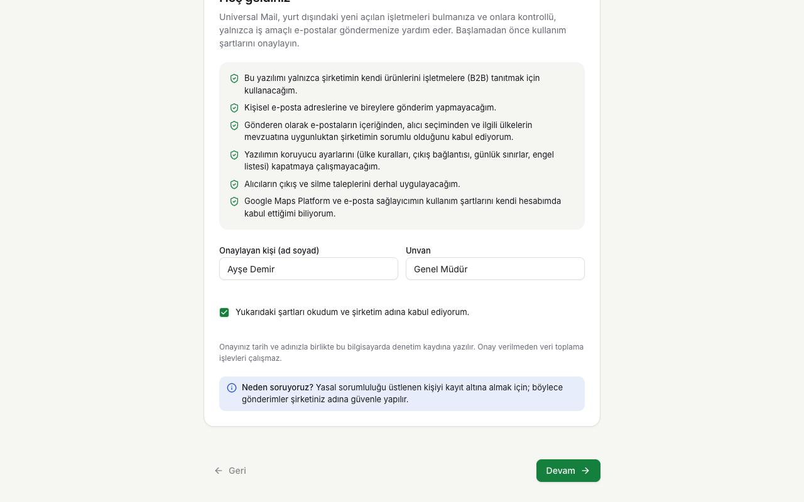

2. **Firma:** E-postaların altında görünecek gönderen bilgileri: ticari unvan, adres, vergi/sicil numarası, telefon ve
   ihracat sorumlusu. Bunlar yasal olarak her e-postada bulunmak zorundadır; eksikse kampanya başlatılamaz.

   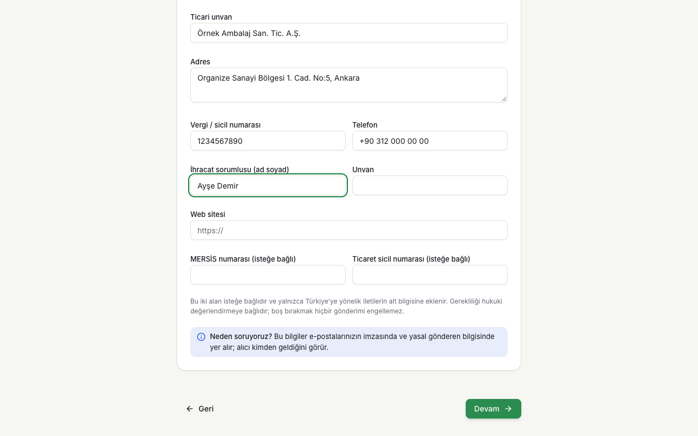

3. **Pazarlar:** E-posta göndermek istediğiniz ülkeleri seçin (ör. Birleşik Krallık, Hollanda). Daha sonra
   Ayarlar'dan değiştirebilirsiniz.
4. **Google:** İşletme verisinin nereden geleceğini seçin.
   - **Demo modu:** Anahtar gerekmez, yapay işletmelerle uygulamayı denersiniz. Öğrenmek için idealdir.
   - **Gerçek Google verisi:** Şirketinizin Google Cloud hesabından alınan **API anahtarı** gerekir. Anahtarı yapıştırıp
     **Anahtarı test et**'e basın; "Anahtar çalışıyor" yazısını görmelisiniz. Anahtarın nasıl alınacağı ekrandaki
     yardım metninde ve [Faz 0 Kılavuzu](04-FAZ0-KILAVUZU.md) Adım 5–7'de anlatılır.

   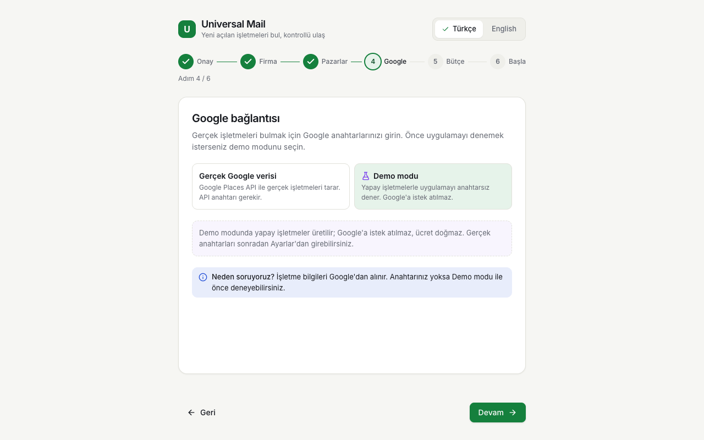

5. **Bütçe:** Google'a aylık en fazla ne kadar harcanabileceğini yazın (ABD doları). Google her ay belirli bir
   ücretsiz kullanım verir; küçük ve orta taramalar çoğu zaman bu ücretsiz kota içinde kalır.
6. **Başla:** Özeti kontrol edip **Kurulumu tamamla**'ya basın.

### 1.2 Ekranın düzeni

Üst menüde beş bölüm vardır:

| Menü | Ne işe yarar |
| --- | --- |
| **Gösterge paneli** | Özet sayılar ve "Kurulumu tamamlayın" kartı |
| **Keşif** | Harita ve işletme listesi; yeni tarama başlatma |
| **Taramalar** | Geçmiş ve süren taramalar, düzenli taramalar, sicil ve içe aktarma |
| **Kampanyalar** | Kampanyalar, Şablonlar, Uyum ve Günlük |
| **Ayarlar** | Google, Gmail, çıkış sunucusu, yedekler ve diğer ayarlar |

Sağ üstte: **DEMO** rozeti (yalnızca demo modunda), **zil** (bildirimler: tarama bitti, yanıt geldi, gönderim
sorunu…) ve **bu ayki Google harcaması / bütçe**.

### 1.3 Gösterge paneli ve "Kurulumu tamamlayın" kartı

Gösterge panelindeki kart, uygulamayı gerçek kullanıma hazırlamak için kalan adımları gösterir. Her satırdaki **Aç**
düğmesi sizi ilgili ekrana götürür. "Demo" etiketli adımlar demo modunda tamamlanmıştır; gerçek kullanım için ayrıca
yapılmalıdır. Hepsi bitince kartı **Gizle** ile kaldırabilirsiniz.

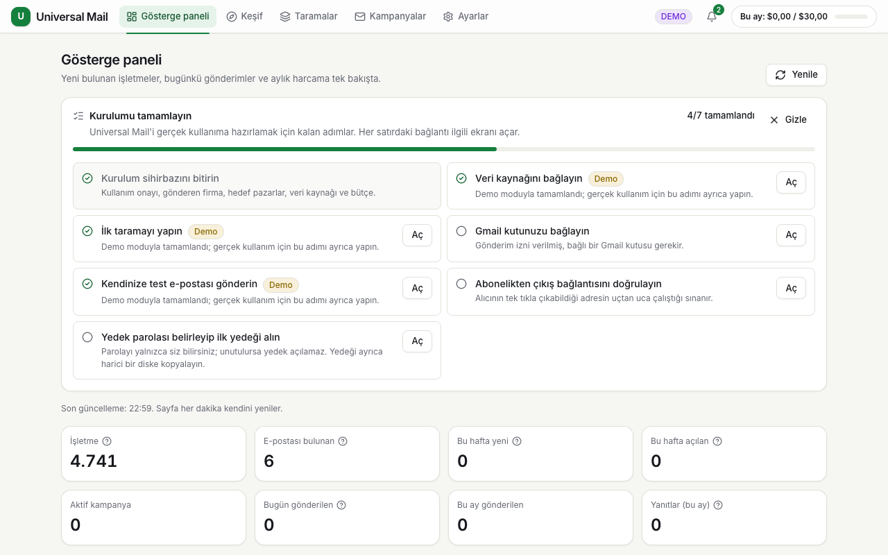

Kartın altında; toplam işletme, e-postası bulunan işletme, bu hafta yeni ve açılan işletmeler, aktif kampanyalar,
bugün ve bu ay gönderilenler ve yanıtlar görünür. Sayfa her dakika kendini yeniler.

---

## 2. Günlük iş akışı

Her gün izleyeceğiniz yol: **tarama → liste → e-posta bulma → şablon → kampanya → yanıtlar**.

### 2.1 Tarama: yeni işletmeleri bulun

1. **Keşif**'e girin ve sol üstte **Yeni tarama** sekmesine geçin.
2. **Nerede?** bölümünde **Şehir seç**'e bir şehir adı yazın ve listeden seçin. İsterseniz **Haritada çiz** ile kendi
   alanınızı çizebilirsiniz.
3. **Ne aranacak?** bölümünde kategorileri işaretleyin (kafe, bar, restoran, otel…). Her kategorinin yanındaki
   "sorgu" sayısı, Google'a kaç arama yapılacağını gösterir.

   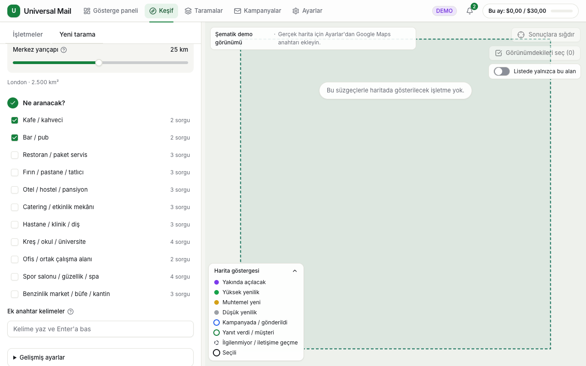

4. Aşağı inip **Maliyet ve onay** kutusunu okuyun: tahmini Google çağrısı, tahmini ücret, bu ay kalan ücretsiz kota ve
   bütçeniz. "Ücretsiz kota içinde" yazıyorsa bu tarama için ödeme yapmazsınız.
5. İsterseniz **Bu taramayı düzenli tekrarla**'yı işaretleyin: aynı bölge seçtiğiniz aralıkla kendiliğinden yeniden
   taranır ve yeni açılan işletmeler işaretlenir.
6. **Taramayı başlat**'a basın.

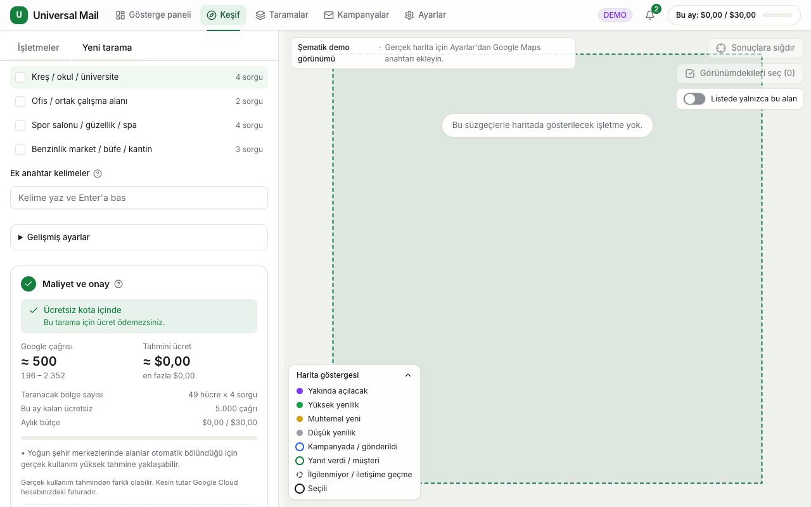

Taramanın ilerlemesini **Taramalar** sayfasında görürsünüz. Bir taramayı **Duraklat** ile durdurup sonra **Devam et**
ile sürdürebilirsiniz. Uygulamayı tarama sürerken kapatırsanız tarama duraklatılır; açınca kaldığı yerden devam
ettirebilirsiniz.

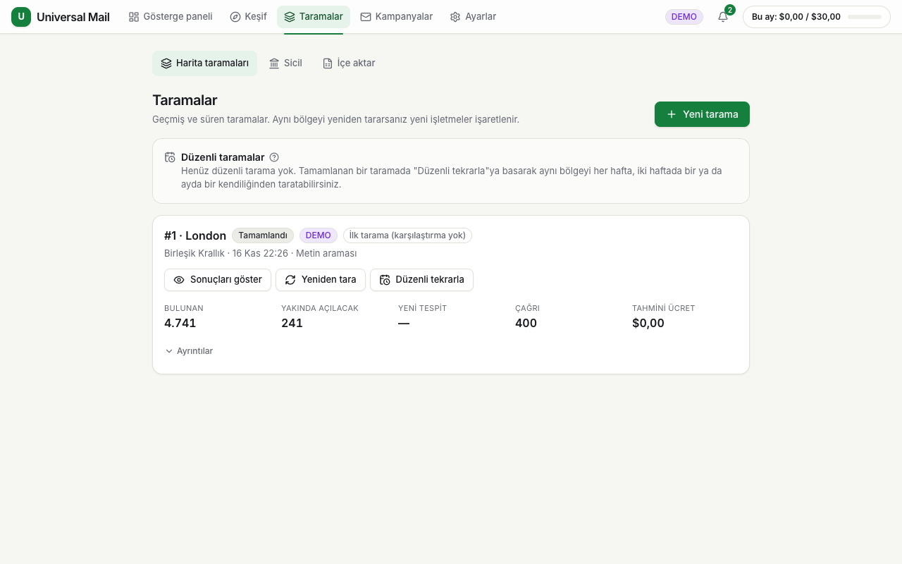

> **İpucu:** Aynı bölgeyi birkaç hafta arayla yeniden tararsanız, uygulama önceki taramada olmayan işletmeleri "yeni"
> olarak işaretler. "Yeni açıldı" tespitinin en güvenilir yolu budur.

### 2.2 Liste ve harita

**Keşif → İşletmeler** sekmesi bulunan işletmeleri listeler, sağdaki harita ise yerlerini gösterir.

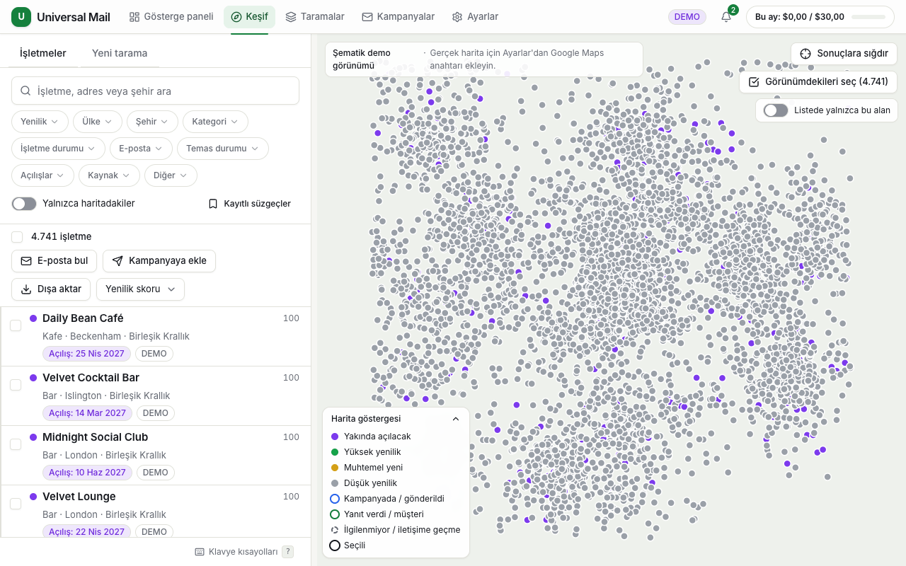

- **Renkler (Harita göstergesi):** mor = yakında açılacak, yeşil = yüksek yenilik, sarı = muhtemel yeni, gri = düşük
  yenilik. Halkalı işaretler kampanyadaki, yanıt veren veya "iletişime geçme" denen işletmelerdir.
- **Arama ve süzgeçler:** Üstteki kutuya ad, adres veya şehir yazın. **Yenilik, Ülke, Şehir, Kategori, E-posta, Temas
  durumu…** düğmeleriyle listeyi daraltın. Sık kullandığınız süzgeçleri **Kayıtlı süzgeçler** ile saklayın.
- **Yalnızca haritadakiler:** açarsanız liste yalnızca haritada görünen alanı gösterir.
- **Toplu işlemler:** Listenin başındaki kutularla işletme seçin; **E-posta bul**, **Kampanyaya ekle**, **Dışa aktar**
  (CSV) veya **Arşivle** kullanın. Arşivleme **Geri al** ile geri alınabilir.
- **Klavye kısayolları:** sol alttaki **Klavye kısayolları** (veya `?` tuşu) listesini açar. `J`/`K` sonraki/önceki
  işletme, `/` arama, `Esc` kapat.

Haritada "Şematik demo görünümü" yazıyorsa gerçek Google haritası yerine basit bir çizim gösteriliyordur. Gerçek
harita için Ayarlar → Google bağlantısı'na **Maps JavaScript API anahtarını** girin.

### 2.3 İşletme ayrıntısı

Listede bir işletmeye tıklayınca ayrıntısı açılır (**Listeye dön** veya `Esc` ile kapanır).

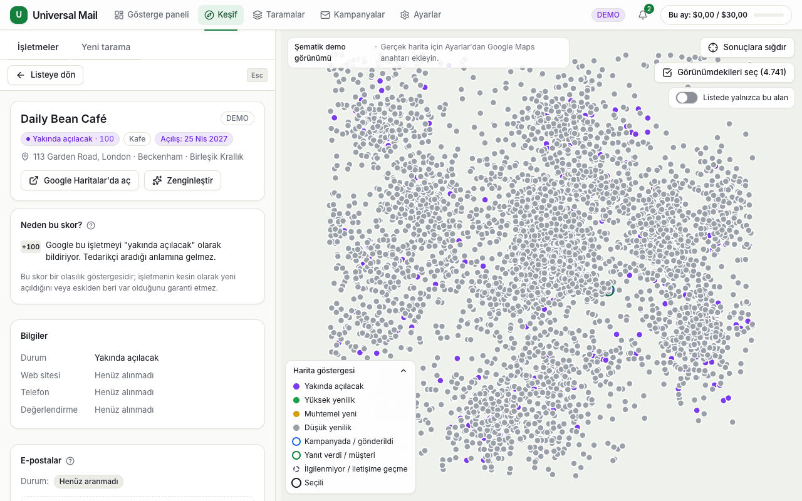

- **Neden bu skor?** İşletmenin neden "yeni" sayıldığını açıklar. Bu bir olasılıktır, kesinlik değildir.
- **Zenginleştir:** web sitesi, telefon ve değerlendirme sayısını Google'dan alır. Küçük bir ücreti vardır; önce
  tahmini maliyet gösterilir, onaylarsanız başlar.
- **Google Haritalar'da aç:** işletmeyi tarayıcınızda Google Haritalar'da gösterir.
- Aşağıda **E-postalar**, kampanya geçmişi ve kendi notlarınız / durum işaretleriniz (ör. "İlgilenmiyor",
  "İletişime geçme") bulunur.

> Google kuralları gereği işletmenin adı, adresi, telefonu ve web sitesi diske kaydedilmez; uygulama kapanınca
> geçici bellekten silinir ve gerektiğinde yeniden yüklenir. Notlarınız ve durum işaretleriniz kalıcıdır.

### 2.4 E-posta bulma

Tek bir işletme için ayrıntıdaki **E-posta bul**'a, birden çok işletme için listedeki **E-posta bul**'a basın. Bir
pencere kaç işletmenin taranacağını gösterir:

- **Web sitesi hazır:** sitesi bilinen işletmeler hemen taranır.
- **Google verisi gerekli:** sitesi henüz bilinmeyenler. Bunlar için **Web sitesi bilinmeyen işletmelerin sitesini de
  Google'dan al** kutusunu işaretlerseniz önce site adresi alınır (küçük bir ücreti vardır, tahmini maliyet yazılır).

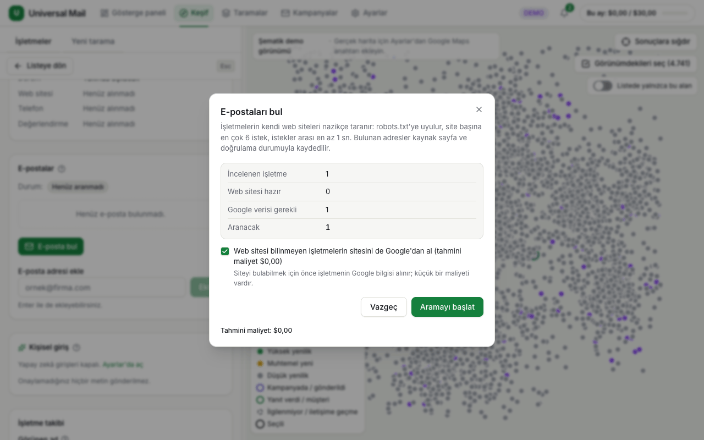

**Aramayı başlat**'a basın. Uygulama işletmelerin kendi sitelerini nazikçe tarar (site başına en çok 6 sayfa, sayfalar
arasında en az 1 saniye, robots.txt kurallarına uyulur). Sonuç birkaç saniye ile birkaç dakika arasında gelir.

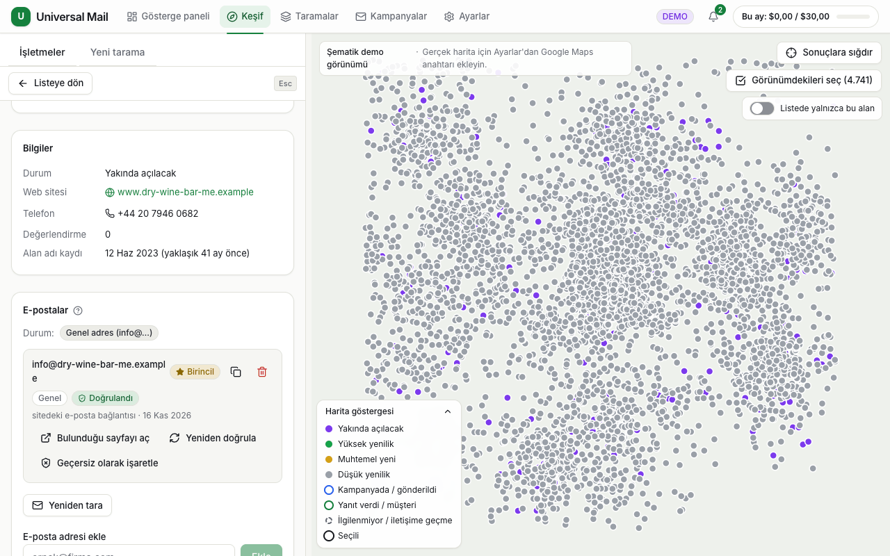

Bulunan adreslerin yanında türü (**Genel** = `info@`, `hello@` gibi işletme adresi) ve doğrulama durumu yazar.
Yapabilecekleriniz:

- **Birincil** yapmak (kampanyada bu adres kullanılır), **Bulunduğu sayfayı aç**, **Yeniden doğrula**,
  **Geçersiz olarak işaretle**.
- **E-posta adresi ekle** ile elle adres girmek (ör. kartvizitten).
- Sitede adres yoksa, Ayarlar → E-posta bulma'dan isteğe bağlı bir harici servis (Hunter veya Snov.io, kendi
  anahtarınızla) açılabilir.

Kişisel posta adresleri (gmail.com, hotmail.com vb.) kampanyalara alınmaz.

### 2.5 Şablonlar

**Kampanyalar → Şablonlar** e-posta metinlerini tutar. Her dil için ayrı şablon vardır (İngilizce, Fransızca,
Hollandaca, Türkçe…).

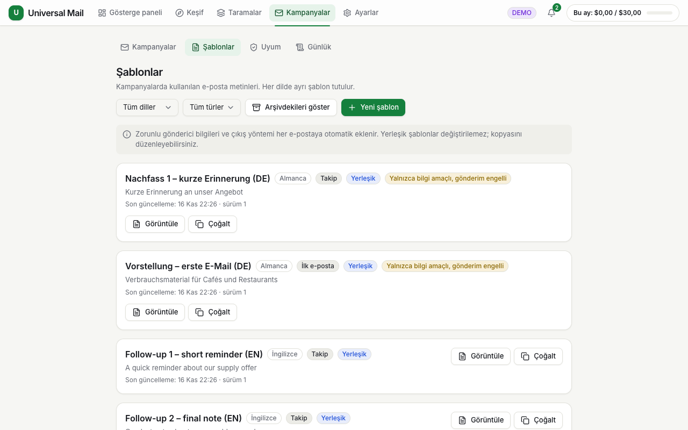

- **Yerleşik** şablonlar değiştirilemez. Kendi metninizi yazmak için **Çoğalt** (veya şablonu açıp **Çoğalt ve
  düzenle**) kullanın.
- **Tür:** "İlk e-posta" kampanyanın ilk adımıdır; "Takip" şablonları sonraki adımlarda kullanılır.
- **Kategori (varyant):** isterseniz kafeler, barlar gibi kategorilere özel şablon yazabilirsiniz; diğerlerine genel
  şablon gider.
- **Konu B:** doldurursanız alıcıların yarısı bu konuyu alır; hangisinin daha çok yanıt aldığını kampanya ayrıntısında
  görürsünüz.
- Sağdaki **Canlı önizleme**, metnin gerçek bir işletmenin bilgileriyle nasıl görüneceğini gösterir.
- Gönderen firma bilgileri ve "listeden çık" bağlantısı **her e-postaya otomatik eklenir**; şablona yazmanız
  gerekmez.
- "Yalnızca bilgi amaçlı, gönderim engelli" etiketli şablonlar (ör. Almanca) o ülkenin kuralları nedeniyle
  gönderilemez.

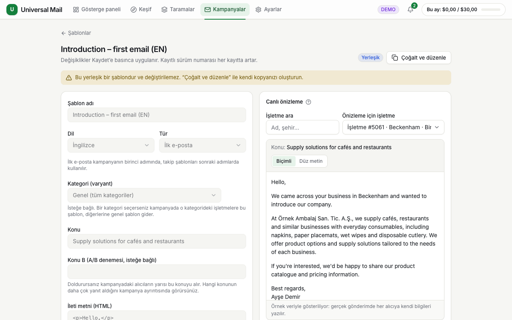

### 2.6 Kampanya

**Kampanyalar → Yeni kampanya** dört adımlık bir sihirbaz açar.

**Adım 1 — Temel ayarlar:** kampanya adı, gönderen posta kutusu, gönderim günleri ve saatleri (alıcının yerel saatiyle,
hafta içi 09.00–17.00 içinde), günlük en fazla e-posta ve iletiler arası bekleme. **Taslağı oluştur**'a basın.

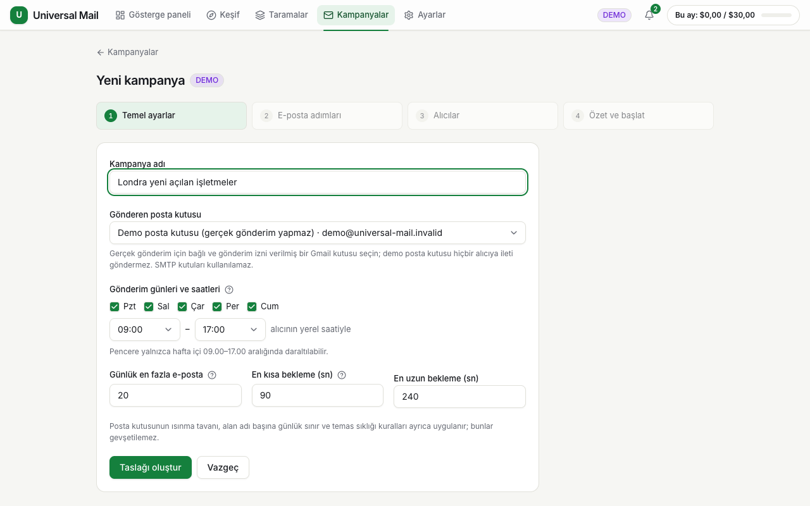

**Adım 2 — E-posta adımları:** hangi dillerde gönderileceğini işaretleyin ve her dil için şablonu seçin. Her işletmeye
ülkesinin dilinde, yoksa İngilizce şablon gider. İsterseniz takip e-postaları ekleyin (bir adrese en çok 3 e-posta).
**Kaydet**.

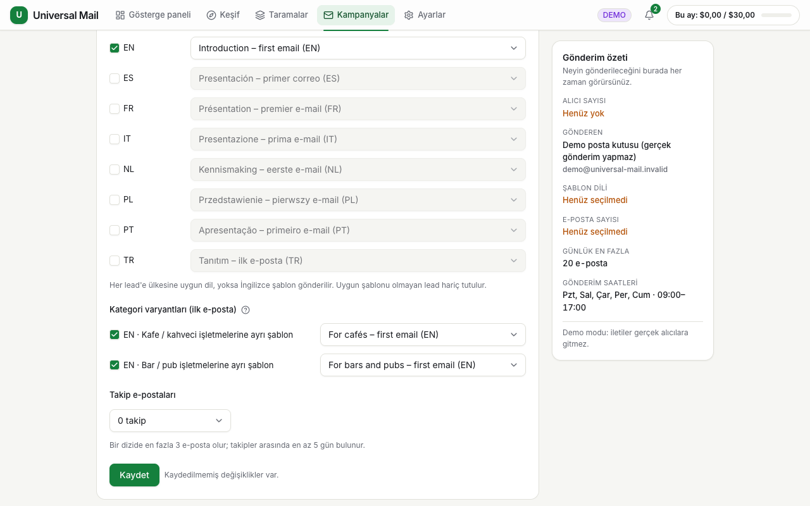

**Adım 3 — Alıcılar:** **Keşif'ten işletme ekle**'ye basın. Keşif ekranı açılır; süzgeçlerle listeyi daraltın (ör.
**E-posta** süzgecinde e-postası bulunanlar) ve **Kampanyaya ekle**'ye basın. Her işletme eklenirken kurallara uygunluk
denetiminden geçer; uygun olmayanlar gerekçesiyle hariç tutulur. **Kampanyaya git** ile kampanyaya dönün.

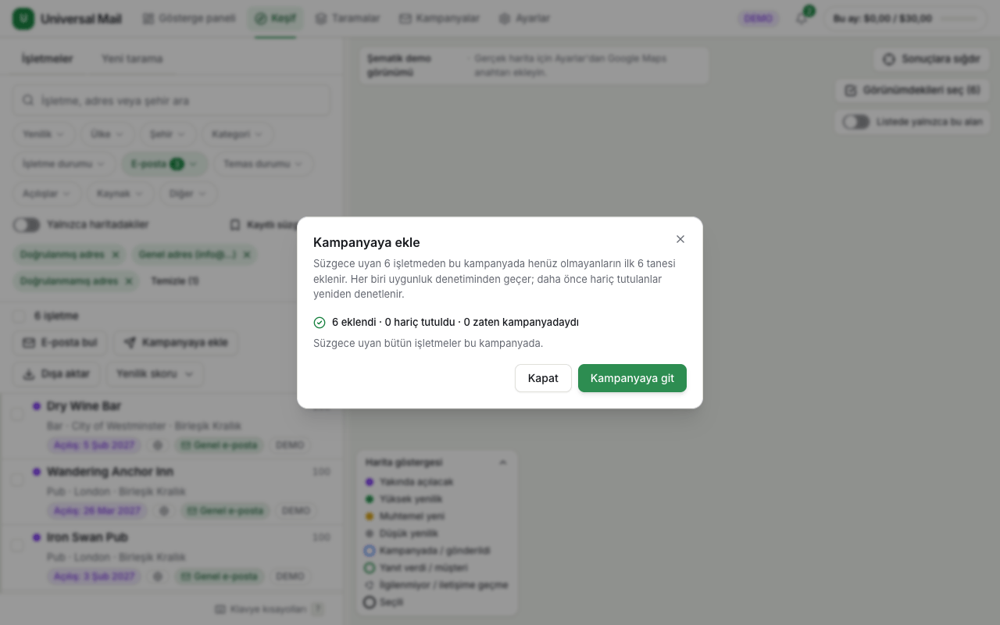

Kuyrukta alıcılar maskeli görünür (ör. `i***@…`). İstemediğiniz alıcıyı **Kampanyadan çıkar** ile çıkarabilirsiniz.

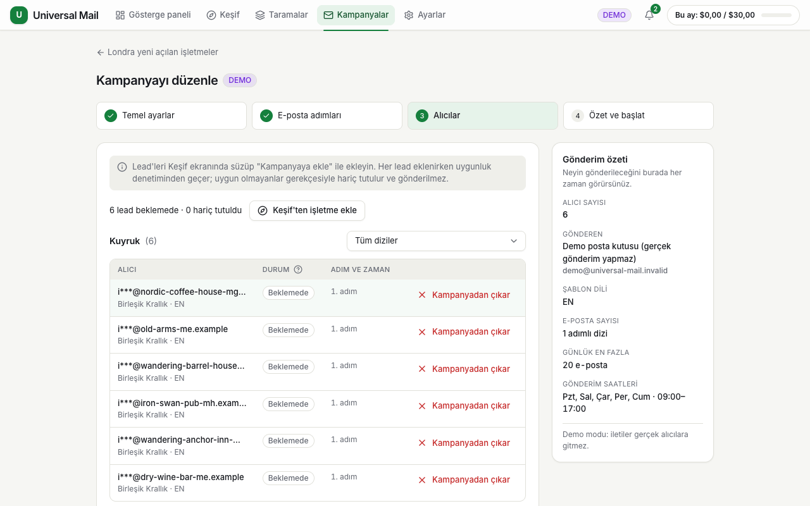

**Adım 4 — Özet ve başlat:** **Başlatmaya hazırla**'ya basın. Uygulama son bir kontrol yapar: başlatmayı engelleyen
bir durum var mı, kaç alıcıya gidecek, günde en fazla kaç e-posta, tahmini kaç gün, en erken gönderim zamanı.

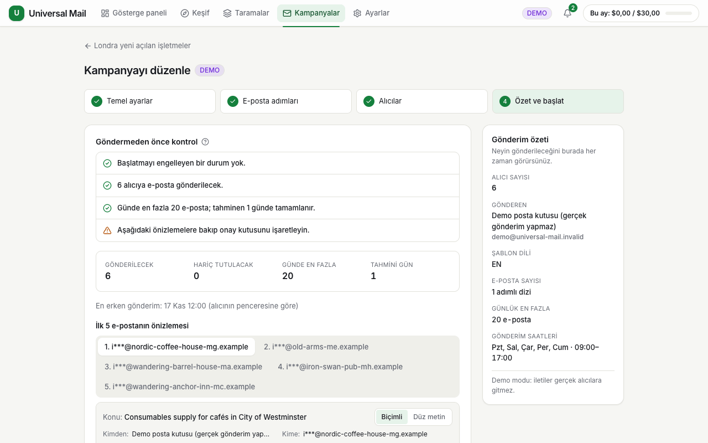

Aşağıda ilk beş e-postanın **önizlemesi** vardır; alıcılar arasında geçiş yapıp her birinin konusunu ve metnini
kontrol edin. **Özeti ve önizlemeleri inceledim…** kutusunu işaretleyip **Başlat**'a basın.

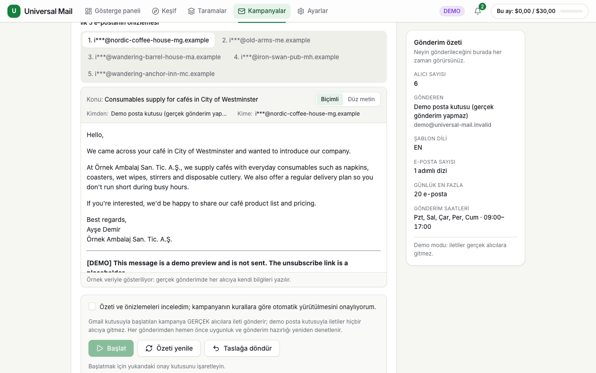

Başlamış bir kampanyayı **Duraklat**, **Devam ettir** veya **İptal et** ile yönetebilirsiniz. Kampanya, uygulama açık
olduğu sürece ve alıcının çalışma saatlerinde gönderim yapar; bilgisayar kapalıyken gönderim durur, açılınca devam
eder.

> **Demo posta kutusu** hiçbir gerçek alıcıya e-posta göndermez. Gerçek gönderim için Ayarlar'da bir Gmail kutusu
> bağlamanız ve çıkış sunucusunu doğrulamanız gerekir (bkz. [3.2](#32-gönderim-hesabı-gmail) ve
> [3.3](#33-abonelikten-çıkış-altyapısı-çıkış-sunucusu)). Hangi adımın eksik olduğunu **Kampanyalar → Günlük →
> Gönderim sağlığı → Canlı gönderime hazırlık** kartı listeler.

### 2.7 Kendinize test e-postası gönderin

Bir kampanyayı başlatmadan önce e-postanın gerçekte nasıl göründüğünü görmek için: **Kampanyalar → Günlük → Gönderim
sağlığı → Kendime test gönder**. Bir şablon ve önizleme işletmesi seçip **Test gönder**'e basın. E-posta yalnızca
gönderen kutunun **kendi adresine** gider; başka alıcı seçilemez ve kampanya sayaçları etkilenmez.

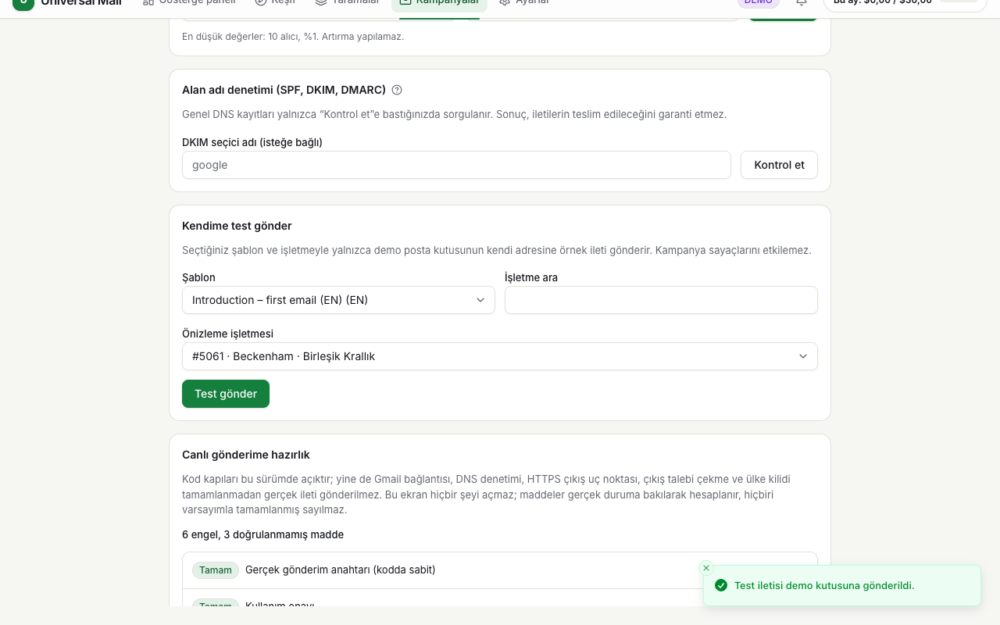

Aynı ekranda **Alan adı denetimi (SPF, DKIM, DMARC)** de vardır. Kendi alan adınızla (Google Workspace) gönderiyorsanız
**Kontrol et**'e basın; kişisel @gmail.com adresinde bu ayarları Google yönetir.

### 2.8 Yanıtlar ve günlük

**Kampanyalar → Günlük** gönderilen ve gelen iletileri gösterir. Adresler gizlilik için maskelidir.

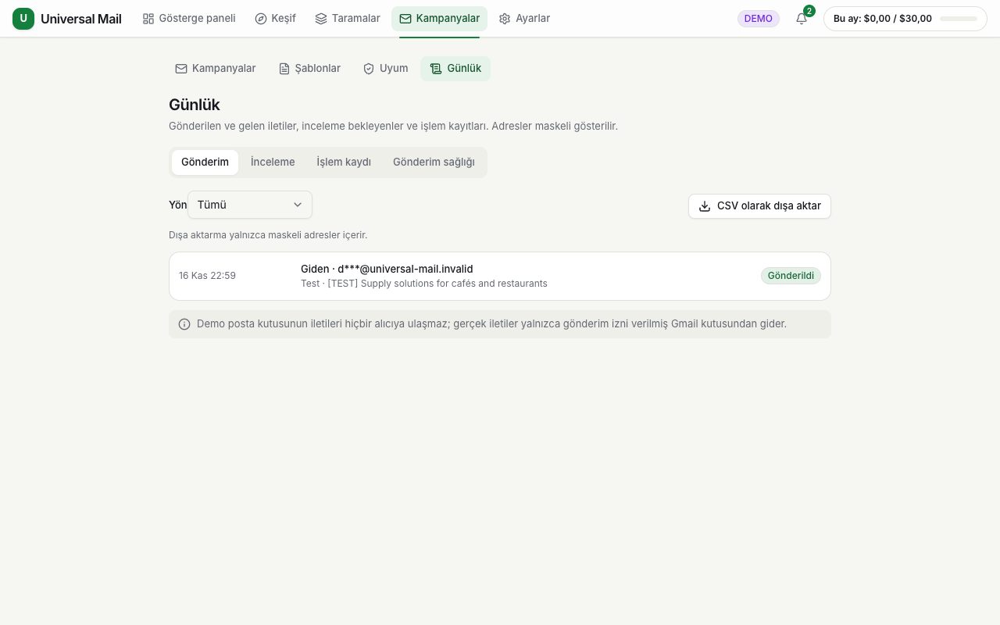

- **Gönderim:** giden ve gelen iletiler. **CSV olarak dışa aktar** yalnızca maskeli adres içerir.
- **İnceleme:** uygulamanın kendi başına karar vermediği iletiler (ör. belirsiz bir yanıt veya belirsiz bir gönderim).
  Kararı siz verirsiniz.
- **İşlem kaydı:** uygulamada yapılan önemli işlemlerin kaydı.
- **Gönderim sağlığı:** test e-postası, alan adı denetimi, otomatik durdurma eşikleri ve canlı gönderime hazırlık.

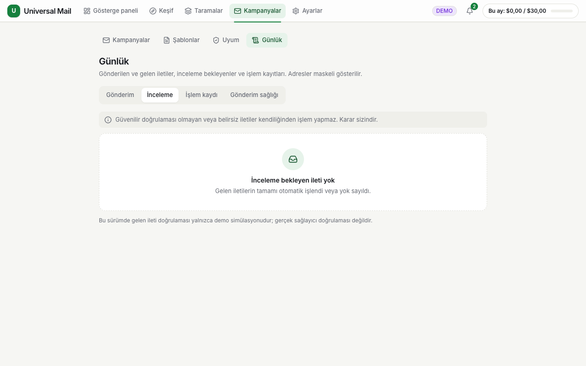

Gmail kutunuza **gelen kutusu okuma** izni verdiyseniz (Ayarlar → Gönderim hesabı → **Gelen kutusu okumayı
etkinleştir**), uygulama yanıtları ve teslim hatalarını kendiliğinden tanır:

- Bir işletme yanıt verirse o işletmeye **takip e-postaları otomatik durur**; zil size haber verir.
- Kalıcı teslim hatası alan adres bir daha kullanılmaz.
- Yanıtların kendisini her zamanki gibi Gmail'de okur ve yanıtlarsınız.

### 2.9 Uyum sayfası

**Kampanyalar → Uyum** üç bölümden oluşur:

- **Ülke politikası:** her ülke için gönderimin serbest, yalnızca genel adrese (info@ gibi) veya engelli olduğunu
  gösterir. Politikayı yalnızca **sıkılaştırabilirsiniz**; gevşetme yoktur.
- **Engel listesi:** bir daha yazılmayacak adresler ve alan adları. Listeden çıkmak isteyenler buraya otomatik eklenir;
  elle de ekleyebilirsiniz.
- **Silme talepleri:** bir kişi verilerinin silinmesini isterse buradan işlenir.

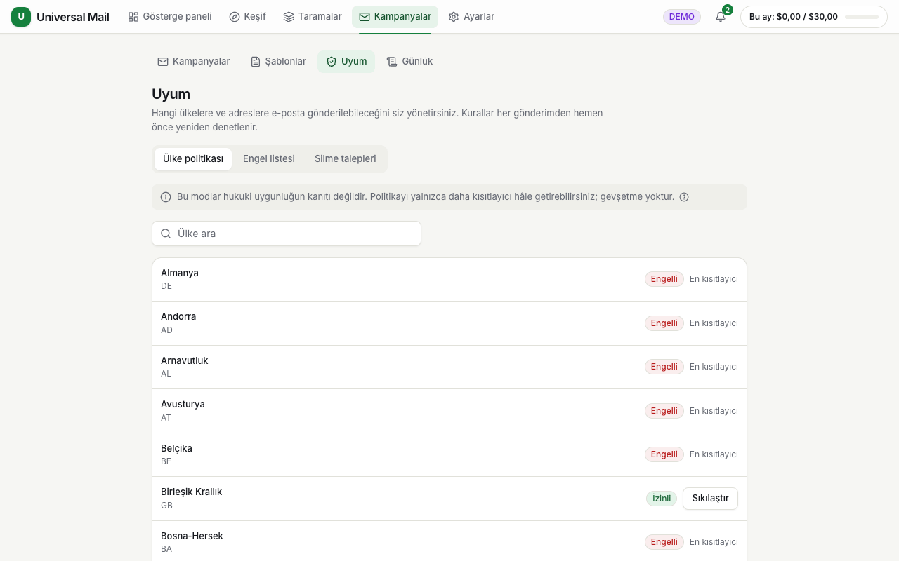

---

## 3. Ayarlar

Ayarlar sayfasının solunda bölümlerin listesi vardır; tıkladığınız bölüme gidilir. Kaydedilmemiş değişiklik varsa her
bölümün altında **Kaydet** düğmesi yeşil olur.

### 3.1 Google bağlantısı ve bütçe

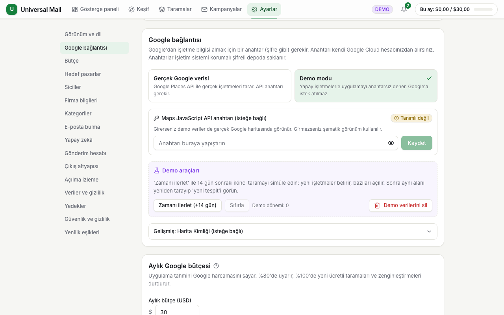

- **Gerçek Google verisi / Demo modu** arasında geçiş yapın.
- **İşletme arama anahtarı** (Places API) ve isteğe bağlı **Maps JavaScript API anahtarı** (gerçek harita için).
  Anahtarı yapıştırıp **Kaydet**, sonra **Anahtarı test et**. Anahtarlar şifreli saklanır ve ekranda bir daha tam
  gösterilmez.
- **Demo araçları** yalnızca demo modundadır: zamanı ileri alıp "yeni açılan" tespitini deneyebilir, demo verilerini
  silebilirsiniz.
- **Aylık Google bütçesi:** harcama %80'e ulaşınca uyarı alırsınız; %100'de yeni ücretli taramalar ve
  zenginleştirmeler durur. Bütçeyi buradan artırabilirsiniz.

### 3.2 Gönderim hesabı (Gmail)

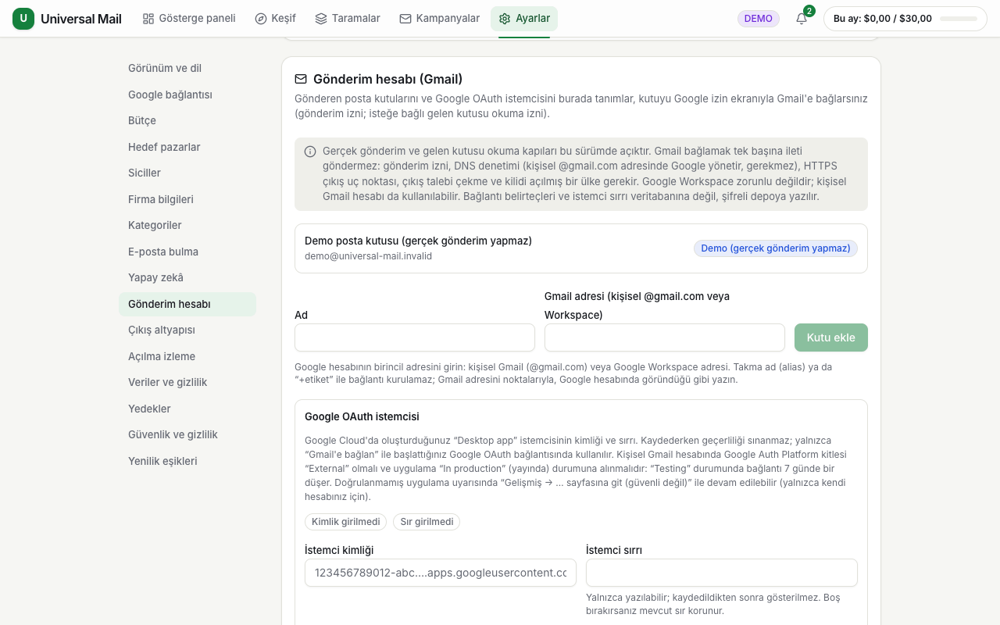

Gerçek e-posta göndermek için şirketin Gmail (kişisel @gmail.com veya Google Workspace) kutusu bağlanır:

1. **Ad** ve **Gmail adresi** yazıp **Kutu ekle**. Adres, Google hesabının birincil adresi olmalıdır (takma ad veya
   `+etiket` olmaz).
2. **Google OAuth istemcisi:** Google Cloud'da oluşturulan "Masaüstü uygulaması" istemcisinin **kimliğini** ve
   **sırrını** girip kaydedin. Nasıl oluşturulacağı: [Faz 0 Kılavuzu](04-FAZ0-KILAVUZU.md) Adım 8.
3. **Gmail'e bağlan (yalnızca gönderim)**'e basın. Bilgisayarınızın tarayıcısında Google izin ekranı açılır. Gönderen
   hesapla giriş yapıp izin verin. "Google bu uygulamayı doğrulamadı" uyarısı çıkarsa **Gelişmiş → … sayfasına git**
   ile devam edebilirsiniz (yalnızca kendi hesabınız için). Bu sırada uygulamayı **kapatmayın**. Sonuç hem tarayıcıda
   hem uygulamada görünür.
4. İsterseniz **Gelen kutusu okumayı etkinleştir** ile yanıtların otomatik tanınmasına izin verin.

Kişisel Gmail'in Google tarafındaki gönderim sınırı düşüktür; uygulama bu yüzden günde az sayıda iletiyle başlar ve
kademeli artırır.

### 3.2a Test modu ve canlı ülke aktivasyonu (gerçek gönderimden önce)

Varsayılan olarak **hiçbir ülke gerçek gönderime açık değildir**: ülke açılmadan kampanya iletisi gönderilemez. Güvenli
ilk kullanım sırası:

1. **Test modunu açın** (Ayarlar → Test modu): kampanya iletileri yalnızca burada yazdığınız **tam e-posta
   adreslerine** gider (alan adı veya joker yok; en çok 50 adres). Kapalıyken alıcı sınırı yoktur. Açıkken ekranın
   üstünde bir uyarı bandı görünür. İzinli listede olmayan alıcılar silinmez, bekletilir. Genel işletme adresleri
   (`info@`, `sales@`) kullanın: kişisel posta sağlayıcıları ve kişi adlı adresler kampanyada zaten uygun sayılmaz.
2. **Gmail'i bağlayın** (3.2) ve **kendinize test e-postası gönderin** (2.7).
3. **Canlı ülke aktivasyonu** (Ayarlar → Canlı ülke aktivasyonu): ön koşulların hepsi "Tamam" olmalıdır (kullanım
   onayı, firma profili, bağlı Gmail kutusu, DNS, doğrulanmış HTTPS çıkış ucu, çıkış taleplerinin çekilmesi, **test modu
   açık ve listesi dolu**, kendime test). Ardından yetkili temsilcinin **yazılı onayını** (belge referansı ve tarihi) ve
   kapsam beyanını girin, **Kontrol et** deyip **Aktive et**'e basın. Bilgisayarda bir **onay penceresi** açılır:
   bilgileri okuyup "okudum" kutusunu işaretleyin ve **Onayla**'ya basın (varsayılan düğme İptal'dir). Bu pencere yalnızca
   yüklü masaüstü uygulamasında çalışır.
4. İlk pilot gönderimleri izinli adreslere yapın. **Üretime geçmek** için Test modunu kapatın (bu bir gevşetmedir:
   onay ister ve çalışan canlı kampanyaları duraklatır; kampanyayı yeniden başlatmak için ayrıca açık onay verirsiniz).

Girdiğiniz onay kaydı, hukuki yetkinin doğrulandığı anlamına **gelmez**: uygulama belgeyi veya kişinin yetkisini
doğrulayamaz, yalnızca kimin hangi belgeye dayanarak açtığını kayda yazar. Hukuki onay uygulama dışında alınmalıdır.

**Geri alma:** aynı kartta açık ülkenin yanındaki **Geri al (kilitle)** ülkeyi yeniden kilitler. Çalışan canlı
kampanyalar önce duraklatılır; kampanyayı sürdürmek açık onay ister ve o ülkenin alıcıları sürdürmede kalıcı olarak
dışlanır (ülke yeniden açılmadıkça).

### 3.3 Abonelikten çıkış altyapısı (çıkış sunucusu)

Her gerçek e-postada alıcının **tek tıkla listeden çıkabileceği** bir bağlantı bulunmak zorundadır. Bu bağlantının
çalışması için internette küçük bir "çıkış sunucusu" gerekir. Önerilen ve ücretsiz yol **Cloudflare Worker**'dır;
kurulumu [Cloudflare Worker rehberi](../deploy/cloudflare-worker/README.md)'nde adım adım anlatılır.

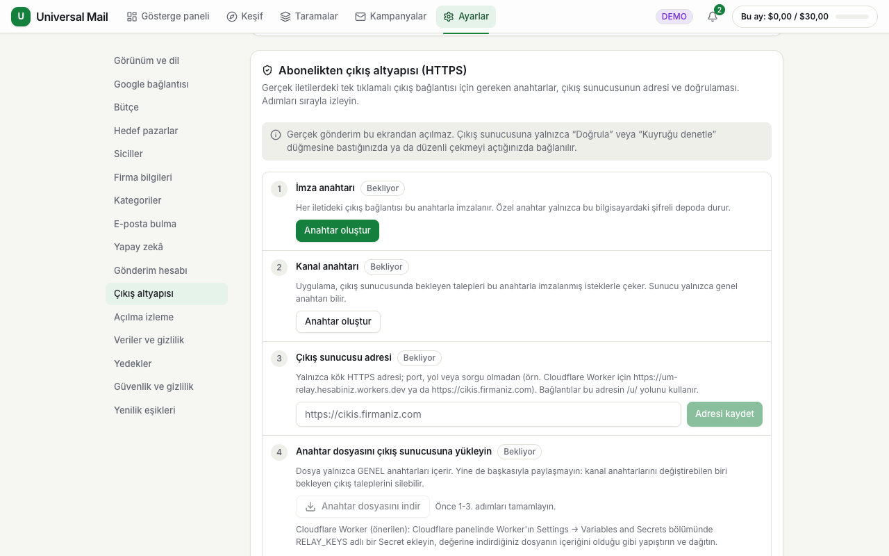

Uygulamadaki adımlar sırasıyla:

1. **İmza anahtarı → Anahtar oluştur**
2. **Kanal anahtarı → Anahtar oluştur**
3. **Çıkış sunucusu adresi:** Cloudflare'in verdiği `https://…workers.dev` adresini yazıp **Adresi kaydet**
4. **Anahtar dosyasını indir** ve içeriğini Cloudflare'de `RELAY_KEYS` gizli değişkenine yapıştırın
5. **Doğrula:** "Uç nokta doğrulandı." görmelisiniz (hiçbir alıcıya dokunmaz)
6. **Kuyruğu denetle:** "Kuyruk sağlıklı."
7. **Talepleri düzenli çek**'i açın: uygulama açıkken dakikada bir çıkış taleplerini alır ve kişileri listeden çıkarır
8. (İsteğe bağlı) şikâyet raporu gönderen sağlayıcıların alan adları

Doğrulama 30 gün geçerlidir; "Talepleri düzenli çek" açıkken uygulama kendiliğinden yeniler. Bir sorun olursa
Kampanyalar ve Uyum sayfalarının üstünde uyarı bandı çıkar (bkz. [Sorun giderme](#74-çıkış-sunucusu-uyarısı)).

### 3.4 Veriler ve gizlilik, güvenlik

**Veriler ve gizlilik** bölümü veri klasörünün yerini, sürümü, kullanım onayınızı ve Google verisinin saklama
kurallarını gösterir. **Google verilerini sil** ile bilgisayardaki Google kaynaklı bilgileri hemen silebilirsiniz
(notlarınız ve durumlarınız kalır).

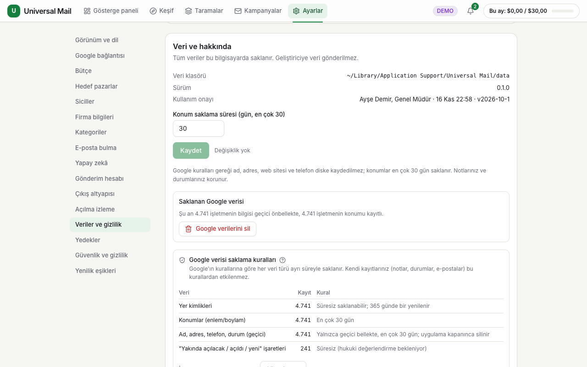

**Güvenlik ve gizlilik** bölümü, uygulamanın hangi hizmetlere **ne zaman** bağlandığını listeler. Bir hizmete yalnızca
siz onu açtığınızda veya anahtarını girdiğinizde bağlanılır. Demo veri kaynağında Google'a ve diğer veri servislerine
(sicil, e-posta bulma, yapay zekâ) bağlanılmaz; ancak bağladığınız Gmail kutusu ve çıkış sunucusu demo veri kaynağında
da kullanılır. Kullanım istatistiği, hata raporu veya arka planda güncelleme denetimi yoktur.

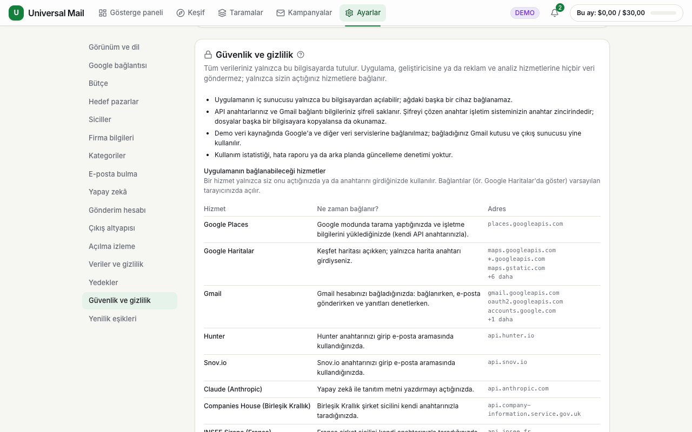

### 3.5 Diğer ayarlar

- **Görünüm ve dil:** arayüz dili (Türkçe / English), tema (Sistem / Açık / Koyu), masaüstü bildirimleri,
  **Bilgisayar açılınca başlat**. Kampanyalar ve çıkış talepleri uygulama açıkken işlendiği için gönderim yapılan
  bilgisayarda "açılınca başlat" önerilir.
- **Hedef pazarlar, Firma bilgileri, Kategoriler, E-posta bulma, Yapay zekâ, Siciller, Açılma izleme, Yenilik
  eşikleri:** kurulumdaki seçimleri ve ayrıntılı tercihleri buradan değiştirebilirsiniz. Her bölümün altında kısa
  açıklama vardır.

---

## 4. Yedek alma ve geri yükleme

Yedekler **Ayarlar → Yedekler** bölümündedir. Yedekler şifrelidir: yedek parolasını bilmeyen kimse açamaz.

### 4.1 İlk kurulumda bir kez

1. **Yedek parolası** belirleyin (en az 10 karakter) ve **Parolayı kaydet**. Parolayı güvenli bir yere yazın:
   **unutursanız yedekler açılamaz ve kimse kurtaramaz.**
2. **Otomatik yedek** açık kalsın: uygulama her gün ilk açılışta ve haftada bir kendiliğinden yedek alır. Eski
   otomatik yedekler kendiliğinden silinir; elle aldıklarınız silinmez.
3. **Yedek klasörü** olarak harici bir disk veya bilgisayarınızla eşitlenen bir bulut klasörü seçin: masaüstü
   uygulamasında **Klasör seç…** ile klasörü seçip alttaki **Kaydet**'e basın (Kaydet'e basmazsanız seçim
   kaybolur). Bilgisayar arızalanırsa yedekler de kaybolmasın.
4. **Kayıtlı anahtarları da yedekle** açıkken Google ve Gmail anahtarları da yedeğe şifreli eklenir; başka bir
   bilgisayara geçerken yeniden girmeniz gerekmez.

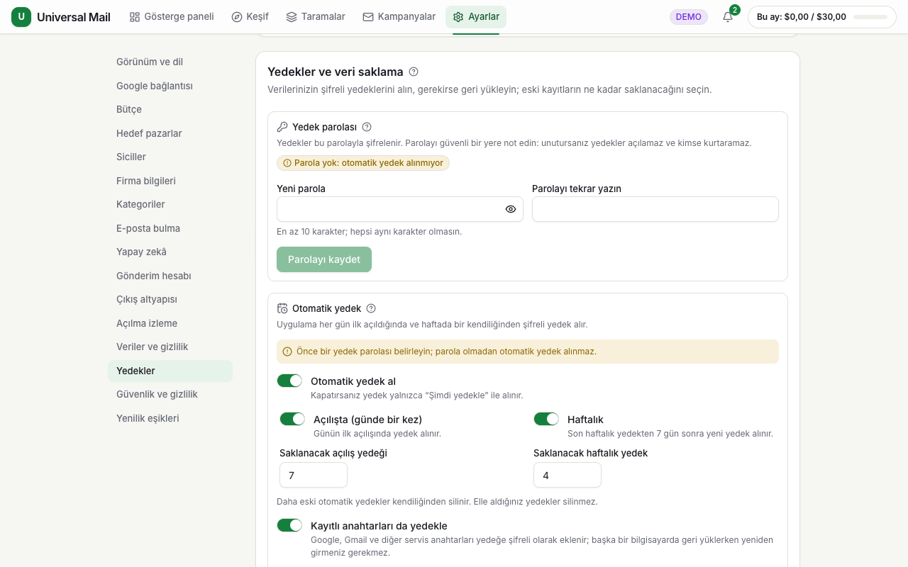

> Ekran görüntüleri tarayıcı görünümünden alınmıştır: klasör alanı orada yazılabilir bir kutu olarak görünür.
> Masaüstü uygulamasında klasör yolu salt okunur gösterilir ve yanında **Klasör seç…** düğmesi bulunur; geri yükleme
> bölümünde de dosya için **Dosya seç…** düğmesi vardır.

### 4.2 Elle yedek almak

**Şimdi yedekle**'ye basın. Yedek listede görünür; **İndir** ile dosyayı (`.umbk`) başka bir yere de
kopyalayabilirsiniz.

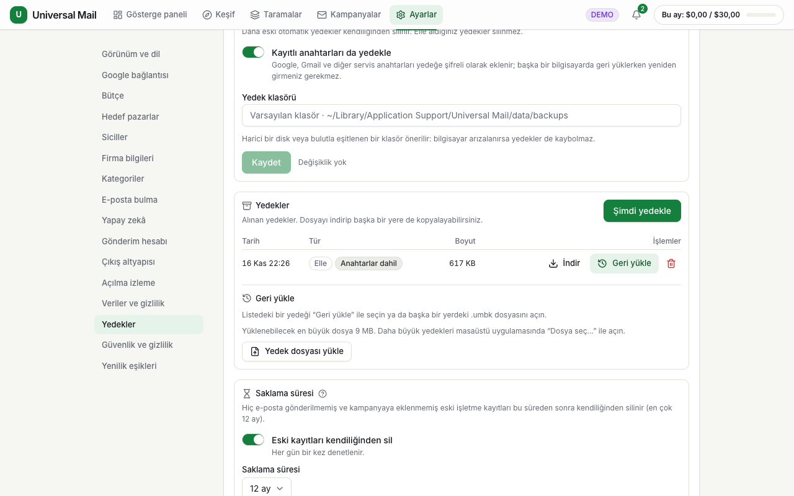

### 4.3 Geri yüklemek

1. Listedeki yedeğin yanındaki **Geri yükle**'ye basın. Başka bir yerdeki `.umbk` dosyası için **Yedek dosyası yükle**
   (masaüstü uygulamasında büyük dosyalar için **Dosya seç…**).
2. O yedeğin parolasını yazıp **Yedeği denetle**'ye basın. Yedeğin içeriği (işletme, kampanya, şablon sayısı ve
   tarihi) gösterilir.
3. Anahtarların da geri yüklenip yüklenmeyeceğini seçin, onay kutusunu işaretleyip **Geri yüklemeyi başlat**.
4. **Uygulamayı kapatıp yeniden açın.** Geri yükleme açılışta uygulanır. Şu anki verileriniz silinmeden önce ayrıca
   kopyalanır.

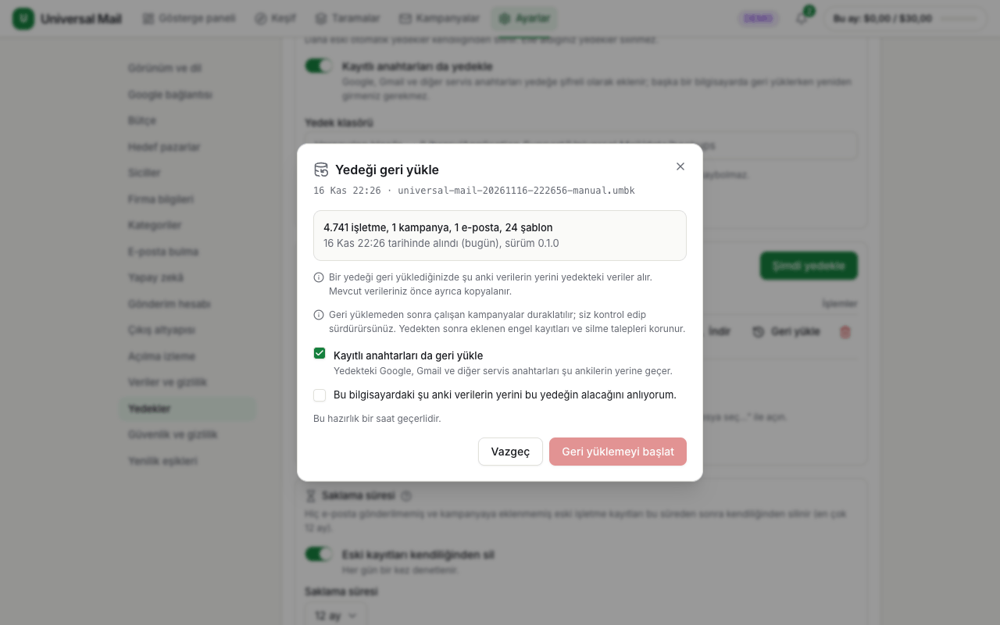

Geri yüklemeden sonra çalışan kampanyalar **duraklatılır**; kontrol edip siz sürdürürsünüz. Yedekten sonra eklenen
engel kayıtları ve silme talepleri korunur. Yeniden başlatmadan önce vazgeçerseniz bölümün üstündeki bantta **İşlemi
iptal et**'e basın.

---

## 5. Veri saklama süreleri ve veri silme

### 5.1 Saklama süreleri

| Veri | Ne kadar saklanır |
| --- | --- |
| Hiç e-posta gönderilmemiş ve kampanyaya eklenmemiş işletme kayıtları | Seçtiğiniz süre, **en çok 12 ay**; sonra kendiliğinden silinir |
| Google'dan gelen konumlar | En çok 30 gün |
| Google'dan gelen ad, adres, telefon, web sitesi | Diske yazılmaz; yalnızca uygulama açıkken geçici bellekte |
| E-posta gönderilmiş / kampanyadaki işletmeler, "iletişime geçme" işaretliler, engel listesi, yasal kayıtlar | Korunur (yasal kanıt için gereklidir) |

Süreyi **Ayarlar → Yedekler → Saklama süresi**'nden seçersiniz. Kutuda "Şu an silinecek" sayısı gösterilir; **Şimdi
uygula** yalnızca bu önizlemedeki kayıtları siler. Denetim her gün bir kez kendiliğinden yapılır.

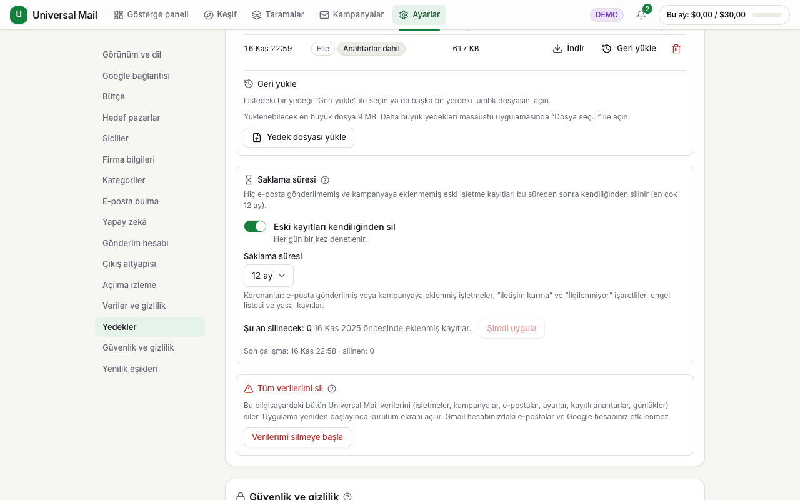

### 5.2 Tüm verilerimi sil

Bilgisayarı devrederken veya uygulamayı bırakırken: **Ayarlar → Yedekler → Tüm verilerimi sil → Verilerimi silmeye
başla**.

1. Pencerede kutuya **VERİLERİMİ SİL** yazın.
2. Yedek dosyalarının da silinmesini istiyorsanız **Yedek dosyalarını da sil**'i işaretleyin (işaretlemezseniz şifreli
   yedekler kalır, ileride geri yükleyebilirsiniz). **Bilgisayarı devrediyorsanız bu kutuyu mutlaka işaretleyin:**
   yedekler kayıtlı anahtarlarınızı ve Gmail bağlantınızı da (parolayla şifreli) içerir.
3. **Silmeyi planla**'ya basın, sonra uygulamayı kapatıp açın. Silme açılışta yapılır ve kurulum ekranı yeniden çıkar.
   Yeniden başlatmadan önce bantta **İşlemi iptal et** ile vazgeçebilirsiniz.

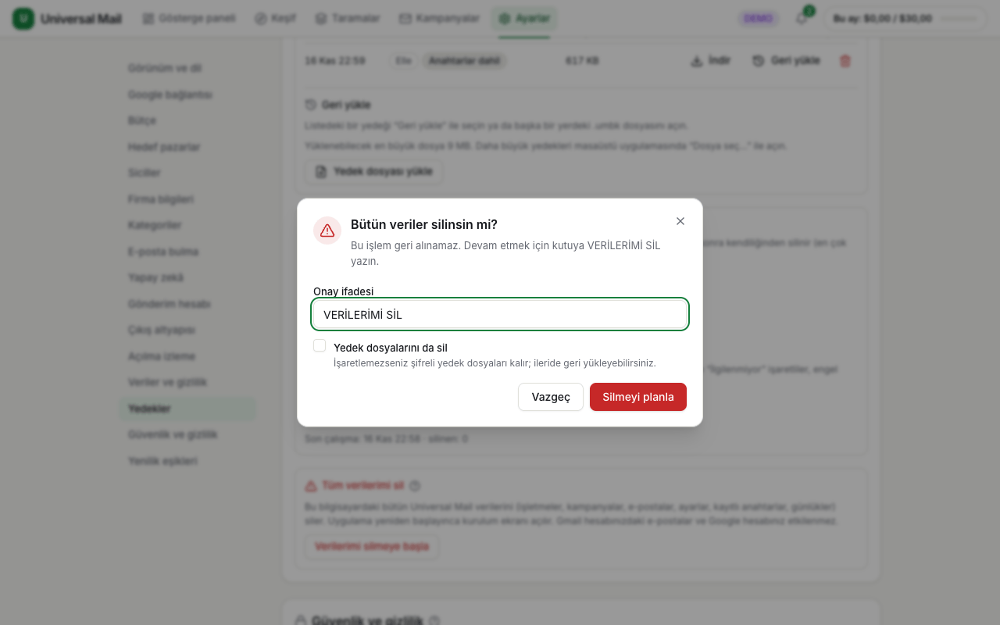

Bu işlem bilgisayarınızdaki işletmeleri, kampanyaları, e-posta kayıtlarını, ayarları, kayıtlı anahtarları ve
günlükleri siler. Gmail hesabınızdaki e-postalar ve Google hesabınız etkilenmez. Uygulamayı bilgisayardan kaldırmak
için: [Kurulum Rehberi → Kaldırma](KURULUM.md#6-kaldırma).

---

## 6. Yasal hatırlatmalar

Uygulama yasal kuralların önemli bir kısmını kendiliğinden uygular, ancak **gönderilen e-postaların sorumluluğu
gönderen şirkettedir**. Kuralların sade özeti: [Uyum Kuralları](UYUM.md). Kısaca:

- **Yalnızca işletmelere (B2B)** ve yalnızca kendi ürünlerinizi tanıtmak için yazın. Kişilere ve kişisel adreslere
  yazmayın.
- E-postalarda **gerçek firma bilgileriniz** bulunur ve her e-postada **tek tıkla çıkış bağlantısı** vardır. Çıkış
  sunucusu çalışmıyorsa gerçek gönderim yapılmaz.
- Bir adrese **en çok 3 e-posta** (ilk e-posta + 2 takip) gider; yanıt gelince takipler durur.
- **Listeden çıkmak isteyenler** hemen engel listesine alınır; onlara bir daha yazılmaz. Silme taleplerini **Uyum →
  Silme talepleri**'nden geciktirmeden işleyin.
- Bazı ülkelerde (ör. Almanya, Avusturya) bu tür e-posta engellidir; bazılarında yalnızca genel adreslere yazılabilir.
  Ülke politikasını gevşetmeye çalışmayın.
- Google Maps Platform ve Gmail kullanım şartları kendi hesabınızda geçerlidir.

Uygulamadaki kontroller hukuki görüş yerine geçmez. Emin olmadığınız bir durumda göndermeden önce danışın.

---

## 7. Sorun giderme

### 7.1 Uygulama açılmıyor (macOS)

- **"Universal Mail açılamıyor, çünkü geliştiricisi doğrulanamıyor"** veya **"Apple … doğrulayamadı"**: ilk açılışa
  özgü bir uyarıdır. [Kurulum Rehberi → macOS ilk açılış](KURULUM.md#23-açılış-güvenlik-uyarısı) adımlarını
  izleyin.
- **"… hasarlı ve açılamıyor"**: uygulamayı Çöp Sepeti'ne atın, kurulum dosyasını yeniden indirip yeniden kurun ve
  yukarıdaki ilk açılış adımlarını izleyin. Sürerse destekle birlikte Terminal'de şu komut çalıştırılır:
  `xattr -dr com.apple.quarantine "/Applications/Universal Mail.app"`.
- **Anahtarlık izni soruyor ("Universal Mail Safe Storage")**: Mac giriş parolanızı yazıp **Her Zaman İzin Ver**'i
  seçin. Uygulama anahtarlarınızı bu kayıtla korur.
- **"Ana anahtar açılamadı" penceresi**: önce **Tekrar dene**'yi (anahtarlık iznini verdikten sonra) seçin. **"Gizli
  bilgileri sıfırla…"yı destek almadan seçmeyin**: kayıtlı anahtarlar ve Gmail bağlantısı yeniden girilmek zorunda
  kalır.
- **"Veritabanı güncellenemedi" penceresi** (yeni sürüm kurduktan sonra): **Yeniden dene** önerilir. "Veritabanı
  kullanımda" diyorsa uygulamanın başka bir penceresi açık olabilir; hepsini kapatıp yeniden açın. Sorun sürerse
  **Güncelleme öncesi yedeğe dön** güvenlidir (hiçbir dosya silinmez) ve **Günlük klasörünü aç** ile günlükleri
  desteğe iletin.
- **"Universal Mail başlatılamadı"**: pencerede günlük klasörünün yeri yazar. Bilgisayarı yeniden başlatıp deneyin;
  sürerse günlüğü desteğe iletin ([7.9](#79-günlükler-nerede)).

### 7.2 Uygulama açılmıyor (Windows)

- **"Windows kişisel bilgisayarınızı korudu" (SmartScreen)**: **Ek bilgi → Yine de çalıştır**. Ayrıntı:
  [Kurulum Rehberi](KURULUM.md#33-smartscreen-uyarısı).
- **Virüs programı dosyayı karantinaya aldı**: kurulum dosyasını yalnızca size verilen GitHub Release bağlantısından
  indirdiğinizden emin olun; virüs programında dosyaya izin verip yeniden kurun.
- **Açılıyor ama boş/beyaz pencere kalıyor**: uygulamayı kapatın (görev çubuğunda sağ tık → Pencereyi kapat), bir
  dakika bekleyip yeniden açın. Sürerse bilgisayarı yeniden başlatın.
- Diğer pencereler (ana anahtar, veritabanı güncellenemedi) macOS ile aynıdır: [7.1](#71-uygulama-açılmıyor-macos).

### 7.3 Google anahtarı hataları

| Uygulamanın dediği | Ne yapmalı |
| --- | --- |
| "Google Places API anahtarı tanımlı değil" | Ayarlar → Google bağlantısı'na anahtarı girin |
| "Google API anahtarı geçersiz ya da bu isteğe izin vermiyor" | Anahtar yanlış kopyalanmış veya kısıtlaması hatalı. Google Cloud → Kimlik Bilgileri'nde anahtarın **Places API (New)** ile kısıtlandığını kontrol edin, yeniden yapıştırıp **Anahtarı test et** |
| "Google Cloud projesinde faturalandırma kapalı" | Google Cloud → Faturalandırma'da şirket kartını bağlayın |
| "'Places API (New)' bu projede etkin değil" | API'ler ve Hizmetler → Kitaplık'ta **Places API (New)**'i etkinleştirin (adında "(New)" olan) |
| "Google kota sınırına ulaşıldı" | Kota sıfırlanınca (genelde ertesi gün) tarama sürdürülebilir; ya da Google Cloud'da günlük kotayı artırın |
| "Aylık bütçe sınırına ulaşıldı" | Ayarlar → Bütçe'den artırın veya gelecek ayı bekleyin |
| Harita gri, "For development purposes only" yazıyor | Maps JavaScript API anahtarının projesinde faturalandırma kapalı veya anahtar kısıtlaması yanlış |
| "Şematik demo görünümü" | Maps JavaScript API anahtarı girilmemiş; gerçek harita için girin (zorunlu değildir) |

### 7.4 Çıkış sunucusu uyarısı

Kampanyalar veya Uyum sayfasının üstünde "Çıkış bağlantısı uyarısı" bandı çıkarsa:

1. **Ayarlar → Abonelikten çıkış altyapısı**'na gidin; hangi adımın "Bekliyor" veya hatalı olduğuna bakın.
2. **Doğrula**'ya basın. "Uç nokta doğrulandı." gelirse sorun çözülmüştür.
3. "Sunucu kanal anahtarını tanımıyor" / "Sunucu isteği kabul etmedi": **Anahtar dosyasını indir** ve içeriğini
   Cloudflare'de `RELAY_KEYS` değerine yeniden yapıştırıp dağıtın; sonra yeniden **Doğrula**.
4. "Sunucuya ulaşılamadı": tarayıcıda çıkış sunucusu adresinizin sonuna `/healthz` ekleyip açın.
   `{"ok":true}` görmelisiniz. Görmüyorsanız Cloudflare panelinde Worker'ın çalıştığını kontrol edin
   ([Cloudflare rehberi, Adım 7](../deploy/cloudflare-worker/README.md)).
5. **Kuyruğu denetle**: talepler uzun süredir bekliyorsa **Talepleri düzenli çek**'in açık olduğundan ve uygulamanın
   açık kaldığından emin olun.

Doğrulama bitmiş veya başarısızken gerçek gönderim kendiliğinden durur; sorun giderilince kampanyalar devam eder.

### 7.5 Gmail bağlantısı

- **Tarayıcıda "Bağlantı kurulamadı"**: sayfadaki ipucunu okuyun. En sık nedenler:
  - Farklı bir Google hesabıyla giriş yapıldı → kutuya yazdığınız adresle giriş yapın.
  - İstenmeyen ek izin → Google Cloud'da yalnızca kılavuzdaki izinleri ekleyin.
  - Bağlantı sırasında uygulama kapatıldı → uygulama açıkken **Gmail'e bağlan**'a yeniden basın.
- **Kutuda "Yeniden bağlanmalı" rozeti / "Gmail bağlantısı yenilenmeli" bandı**: izin Google hesabından kaldırılmış
  veya süresi dolmuş. **Yeniden bağlan**'a basın. Bu sırada kampanya gönderimleri ertelenir, kaybolmaz.
- **Her hafta yeniden bağlanmak gerekiyor**: Google Cloud'da OAuth uygulaması "Testing" durumunda kalmış. **In
  production** (yayında) durumuna alın ([Faz 0 Kılavuzu](04-FAZ0-KILAVUZU.md) Adım 8).
- **"Google bu uygulamayı doğrulamadı"**: tek kullanıcılı kurulumda normaldir; **Gelişmiş → … sayfasına git** ile
  devam edin.

### 7.6 Tarama takıldı veya duraklatıldı

- **Taramalar** sayfasında taramanın yanında nedeni yazar (bütçe doldu, Google kotası, ağ kesildi, uygulama
  kapatıldı…). Nedeni giderip **Devam et**'e basın.
- **"Arka plan işçisi çalışmıyor" bandı**: taramalar, gönderimler ve çıkış talepleri durur. Uygulamayı tamamen kapatıp
  yeniden açın. Bant geri gelirse günlükleri desteğe iletin.
- **"Düzenli taramalar şu anda çalışmıyor"**: bandaki **Yeniden başlat**'a basın.
- İlerleme hiç değişmiyorsa internet bağlantınızı kontrol edin; demo modunda internet gerekmez.

### 7.7 "Veritabanı şu an meşgul"

O sırada bir yedek alınıyor veya büyük bir işlem sürüyor olabilir. Birkaç saniye bekleyip yeniden deneyin. Sık
tekrarlanıyorsa uygulamayı kapatıp yeniden açın. Bilgisayar uykudan yeni uyandıysa bir dakika bekleyin.

### 7.8 Geri yükleme başarısız

| Uyarı | Ne yapmalı |
| --- | --- |
| "Parola bu yedeğe uymuyor" | Yedeğin **alındığı andaki** parolayı yazın (parolayı sonradan değiştirdiyseniz eskisi) |
| "Yedek dosyası bozulmuş veya değiştirilmiş" | Listeden başka (daha eski) bir yedek deneyin |
| "Bu dosya bir Universal Mail yedeği değil" | `.umbk` uzantılı doğru dosyayı seçin |
| "Bu yedek uygulamanın daha yeni bir sürümüyle alınmış" | Önce uygulamayı en son sürüme güncelleyin ([Kurulum Rehberi](KURULUM.md#5-güncelleme)) |
| "Dosya yükleme için çok büyük" | Masaüstü uygulamasında **Dosya seç…** ile seçin |
| "Geri yükleme hazırlığının süresi doldu" | Hazırlık bir saat geçerlidir; yedeği yeniden seçip parolayı tekrar girin |
| "Yeniden başlatmayı bekleyen bir işlem var" | Uygulamayı kapatıp açın veya bantta **İşlemi iptal et** |

Yeniden başlattıktan sonra veriler beklediğiniz gibi değilse hiçbir şey kaybolmamıştır: geri yüklemeden önceki
verileriniz ayrıca kopyalanmıştır. Destekle iletişime geçin.

### 7.9 Günlükler nerede?

Masaüstü uygulamasında menüden **Yardım → Günlük klasörünü aç** (veri klasörü için **Yardım → Veri klasörünü aç**).

| Sistem | Günlük klasörü | Veri klasörü |
| --- | --- | --- |
| macOS | `~/Library/Application Support/Universal Mail/logs` | `~/Library/Application Support/Universal Mail/data` |
| Windows | `%APPDATA%\Universal Mail\logs` | `%APPDATA%\Universal Mail\data` |

Desteğe yalnızca **`app.log`** dosyasını ve gerekirse **`data/migrate-result.json`**'ı gönderin; bunlar kişisel veri
içermez. **Veritabanı dosyasını (`.db`), `secrets.json`'ı, ana anahtar dosyalarını ve yedek parolanızı kimseyle
paylaşmayın.** Destek bunları hiçbir zaman istemez.
